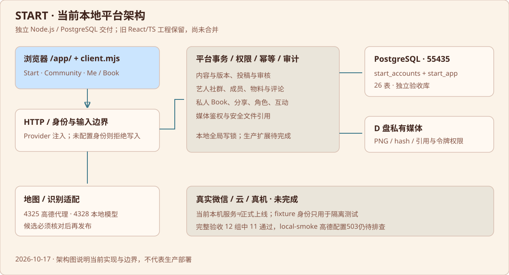

# 技术架构与代码地图



## 当前实际架构

现役平台是原工作区外的独立 Node.js ES Module 交付，采用模块化单体思路。前台是原生浏览器 JavaScript、HTML、CSS，后端为 node:http + pg + Zod，数据库 PostgreSQL。旧工程是 React/TypeScript/Vite + worker 等代码，保留在多个 Git 工作树中，尚未与最新独立交付统一。

```text
浏览器 /app/（公开页面、投稿、Community、Market、Book）
               │ createPlatformClient
               ▼
src/http.mjs（身份验证入口、请求限制、JSON/媒体/静态路由）
               │
src/platform.mjs（事务、幂等、读模型、跨模块调度）
 ├─ content.mjs   草稿/发布/版本、投稿/审核、地点与路线
 ├─ community.mjs 社群创建/唯一性/成员/有限管理
 ├─ market.mjs    物料/申请/状态/公开评论
 ├─ personal.mjs  资料、Book/分享、娃娃、收藏/通知、注销
 ├─ media.mjs + public-media.mjs  私有文件与公开引用鉴权
 └─ context.mjs   当前账号、管理员、所有权和关联实体检查
               │
PostgreSQL start_accounts + start_app + D盘媒体文件

src/integrations.mjs
 └─ 复用 Admin Preview Server
     ├─ localhost:4325 → 高德固定域名/路径代理
     └─ localhost:4328 → 本地Qwen/llama-server候选提取
```

身份在 createServer({verifyBearer, repository}) 注入；当前 server.mjs 未配置 verifyBearer，因此实际服务写入拒绝，不能用客户端传入 userId 或角色字段替代。地图与识别通过固定本地适配层调用，Provider 目标是解耦，但现有文件仍跨目录导入，尚未形成完全独立可发布的包。

## 现役文件职责

| 文件/目录（相对现役目录） | 责任 |
| --- | --- |
| boot.mjs | 启动已存在PG集群，核对55435实际数据目录，建立验收DB后导入server |
| server.mjs | 执行schema、清理已注销用户私有媒体、组装HTTP服务，监听4330 |
| src/runtime.mjs | 从旧工作树 node_modules 解析 pg/zod；迁机必须处理 |
| src/contracts.mjs | 所有命令的输入白名单、长度/枚举/ID/坐标完整性验证 |
| src/platform.mjs | execute事务、读查询、推荐、分享令牌解析、home配置读取 |
| src/context.mjs | 数据存在性、已发布/草稿、用户所有权、管理员检查及通知写入 |
| src/content.mjs | 艺人/地点/路线/演出保存发布；投稿/纠错/批量导入及审核 |
| src/community.mjs | 创建申请、审批、成员关系、管理员修改范围、转让/解散申请 |
| src/market.mjs | 物料发布编辑、状态、申请接受撤回、公开评论与删除 |
| src/personal.mjs | 资料、打卡历史快照、按字段分享、唯一角色、注销清理 |
| src/media.mjs | PNG上传/尺寸/魔数/解码、文件安全路径、图片鉴权读取 |
| src/public-media.mjs | 图片被哪些公开内容/审核对象引用的判定 |
| src/http.mjs | 请求Host/Origin、JSON大小、身份、HTTP错误码与所有接口 |
| src/static.mjs | 当前静态文件及旧批准稿白名单回退，阻止路径逃逸 |
| client.mjs | 浏览器API、鉴权令牌注入点、照片转PNG、私有图片blobURL |
| public-ui/public.js | 当前hash路由、统一公开目录、页面编排与模块挂载 |
| public-ui/private-views.mjs | Me只读聚合、地点/路线投稿表单结构 |
| public-ui/submission-tools.mjs | 地图选点、文字候选核对、站点添加与草稿状态 |
| public-ui/route-stops.mjs | 本地SortableJS驱动拖动、键盘替代操作与有序站点合同 |
| public-ui/community-membership.mjs | 加入/退出、我的社群、异步响应与重复操作处理 |
| public-ui/market.mjs | 发布/编辑/状态、申请与评论界面 |
| public-ui/book.mjs | 新建、私人列表/详情、票根、分享选择/预览/撤销/删除 |
| ui/ | 当前后台独立接线副本，不替换原审批稿 |
| tests/ + acceptance.mjs | DB/HTTP/浏览器/备份/旧原型/集成总验收 |

## 共享实体与联通方式

content 表统一承载 artist/place/route/event，kind区分类型，draft和published分开，修改递增version并留revisions。地点用poi_id去重；contributions记录“某艺人在某地点的证据”。路线 placeIds 保持顺序；演出 artistIds + placeId 绑定艺人和场馆；社群 artist_id 唯一；物料同时引用community/artist/可选event/place；打卡引用place并保存快照。

这使同一个placeId可出现在艺人列表、社群城市地点、路线站点、演出场馆及私人记录里。前端通过统一公开查询与实体详情读取，不为每页复制地点档案。已保存的Book快照不随公共地点撤回或改名被抹掉。

## 事务与权限

命令先验证schema；事务内先取全局advisory lock，再锁定有效账号。幂等键按user/operation/key存储，重复同载荷返回旧结果，不同载荷冲突。审核新路线、站点复用和贡献写入在同一事务；失败回滚。公开查询只序列化白名单字段，私有查询按当前账号过滤。

这是本地正确性优先方案。全局写锁、部分全表读后内存筛选、无分页、开发trust用户和单个大platform模块都是上线前需处理的成本，不应直接扩为微服务。首先整理依赖和部署边界，再按负载细化索引、分页和锁范围。

## Git、目录与版本身份

本地外层根不是Git仓库。旧主仓库和工作树见 evidence/current/GIT_STATE.json：master的HEAD为1def607…；phase-c为45a44b3…；v0.2地图为b9a4623…；角色基线为a8ece97…。这些工作树均存在未提交/未跟踪内容，交接时未重置或清理。

2026-10-17的GitHub同步记录显示私有仓库 happywanderingartist/start 已备份旧主工程/分支；同步记录明确排除重复deliveries。用户随后已明确授权本项目最新成果全部入库。本次更新将当前平台作为仓库main入口，旧main归档分支保留，全部历史交付与原始素材放同仓库Release附件；具体提交与范围见仓库根README及docs/sync。功能层面仍未把两套框架重构合并，不能称已完成架构统一。
