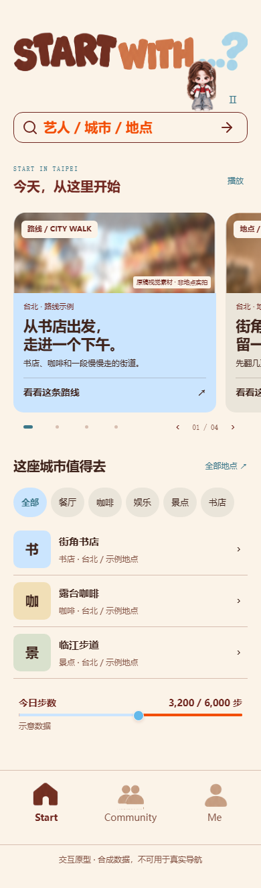
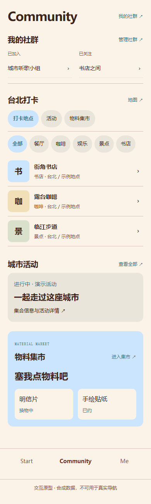
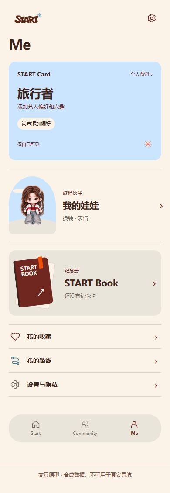
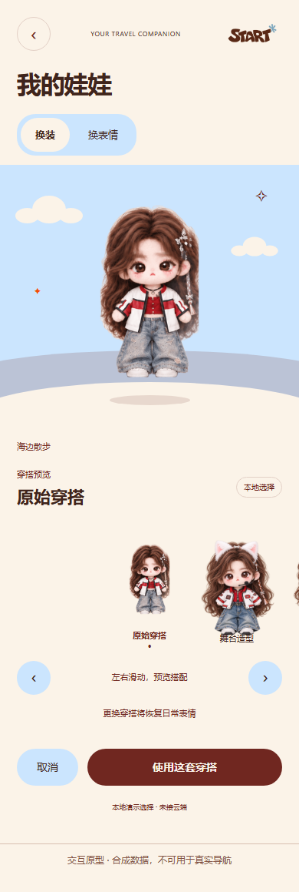
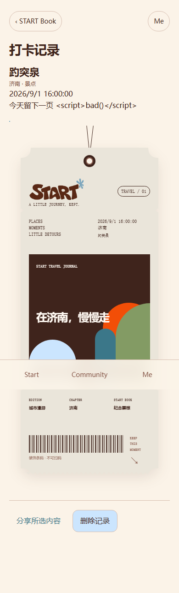
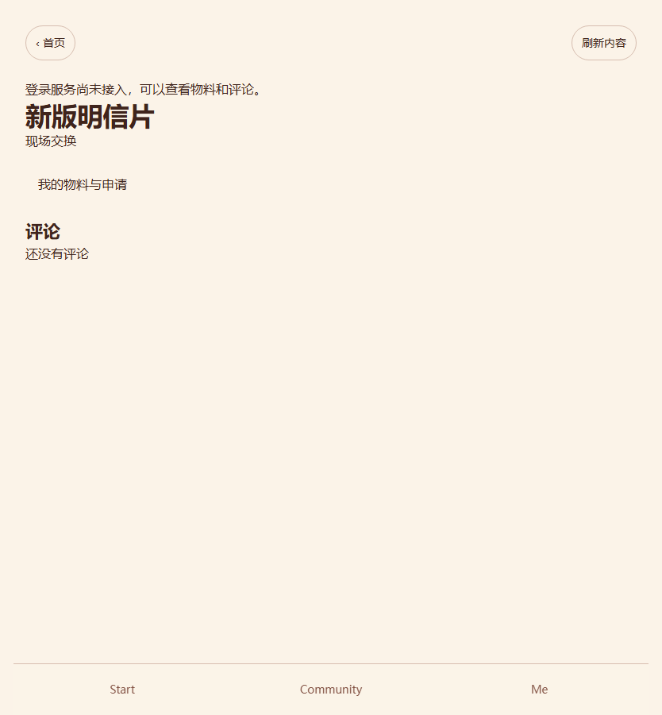
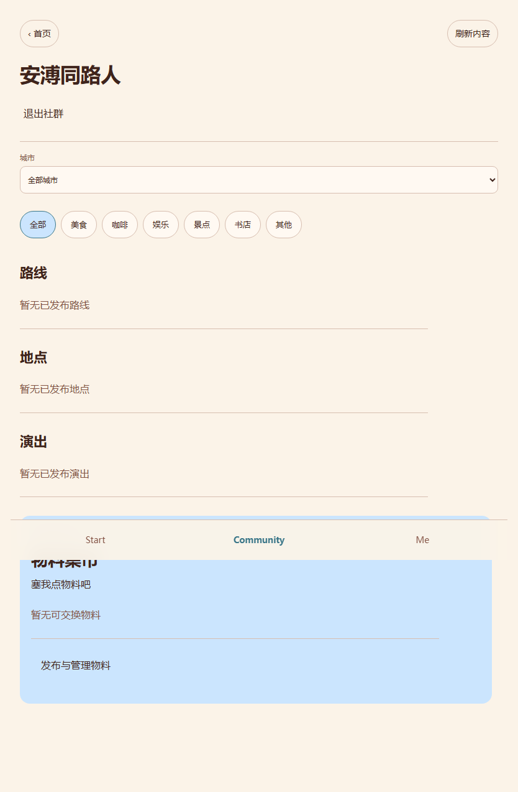

# 视觉方向、截图与素材验收

## 设计合同

首页以用户已经设计好的稿件为基准，保持原Logo、卡片排布与组合色卡。系统底座深度参考Apple Music：清楚的标题层级、内容分组、克制的导航与返回、内容照片为主；参考图用于卡片、堆叠、滑动和动效细节，避免泛化成AI模板。

色卡组合包括冰蓝#CBE5FE、奶油#FBF3E8、橙#F24E07、咖啡#702720，以及深咖#3F241C、陶土黄#DD9F45、叶绿#839B64、亚麻#EAE5DA、湖蓝#3B7789。页面以浅底/咖啡文字为底，冰蓝用于主要交互，其他颜色有节制地点缀；不是所有模块一片蓝，也不铺绿色配土黄。个别原截图标注与视觉像素可能有误差，优先用户确认的组合和实际tokens。

票根参考REF_28，保留长票根轮廓、挂绳/孔、虚线分区、图形/照片海报和装饰条码；条码不具有真实入场功能。娃娃保持单独人物与原始比例，背景动态；服装和表情滑动选中居中放大、呈弧形排布的方向保留，素材不足时如实说明。

## 历史已确认方向（不是本次DB接线截图）

上述图片来自START_FINAL_LAYOUT_REVIEW_2026-10-06，是后续整合应参考的视觉基准。旧稿有fixture、sessionStorage和演示文案；不能把它们直接称为已接新数据库的产品截图。

## 当前数据接线页面（测试数据）

Book图来自隔离测试，含验证转义的`<script>`测试文字，不是恶意执行或用户正式投稿。极小单色照片是上传权限测试素材，不是最终演示封面。照片封面版票根尚未完成。本包如实展示当前实现，不能据此称最终视觉已经获批。

## Open Design与展示边界

用户硬性要求使用相关成熟skill与Open Design。历史有同步独立预览脚本，当前原生项目/旧端口未恢复，启动操作曾被自动审核额度故障拒绝。下一agent应恢复工具连接后核对工作目录、项目和可编辑内容，不仅给失效localhost链接；同时交直接图片供用户确认。

本交接包的离线HTML用于阅读，源页面与CSS可编辑；它不等于Open Design原生画布已创建或已复核。新视觉仍按用户阶段确认，不能把本次“打包交接”当成视觉批准。
