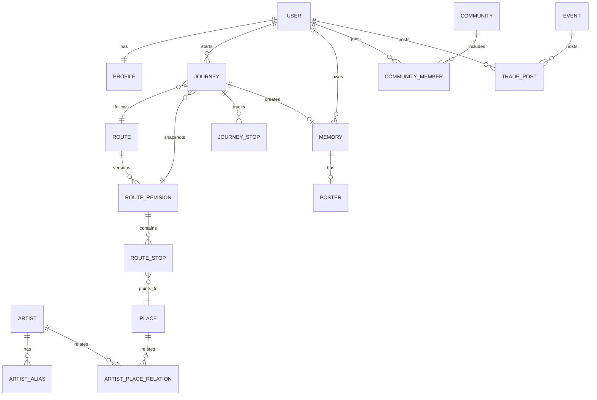

# START — Domain Model V2

日期：2026-10-01  
状态：产品领域模型基线。  
目的：让产品、数据库、API、Figma、Codex 对同一对象说同一种语言。

## 1. 建模原则

1. 公共内容与用户行为分离。
2. Route 与 Journey 分离。
3. “地点存在”与“地点和艺人有关”分离。
4. Evidence 是一等对象，不埋在自由文本里。
5. 已发布内容必须可版本重现。
6. 未核验可以存在，但状态必须可见。
7. Event/Community/Trade 不塞进 Route 的通用 JSON。
8. P0 不为未来功能提前建大量空表。

## 2. User / Profile / Interest

User：
- id
- auth_identity
- created_at
- status

Profile：
- user_id
- nickname
- avatar
- city nullable
- bio nullable
- privacy settings

Interest 支持：
- category
- artist
- fandom behavior
- taste tag
- city

`UserInterest(user_id, interest_id, weight/source)`

P0 允许显式兴趣 + 简单行为权重。

## 3. Artist

Artist：
- id
- canonical_name
- type
- primary_media
- verification_state

ArtistAlias：
- artist_id
- alias
- locale
- normalized_alias

同名艺人必须允许歧义存在。

## 4. City

- id
- name
- country_code
- administrative_code nullable

城市是稳定实体，不从任意字符串猜行政归属。

## 5. Place

- id
- city_id
- name
- address
- longitude nullable
- latitude nullable
- coordinate_system
- verification_state
- verified_at nullable

外部地图 provider ID 不作为 START 主键。

PlaceProviderRef：
- place_id
- provider_key
- provider_place_id
- observed_at
- source_ref

## 6. ArtistPlaceRelation

表达“为什么这个地点和某艺人有关”。

- id
- artist_id
- place_id
- relation_type
- explanation
- verification_state

`Place verified` 不等于 `ArtistPlaceRelation verified`。

## 7. EvidenceSource

- id
- source_type
- url nullable
- public_title
- public_excerpt nullable
- observed_at
- review_state
- visibility

来源类型可包括：
- artist_social
- official_interview
- official_event
- media
- program
- fan_submission
- other_public

私有审核备注不能进入 public DTO。

## 8. Route

稳定身份：
- id
- slug
- city_id
- linked_artist_id nullable
- publication_state
- published_revision_id nullable

Route 不保存用户 visitStatus。

## 9. RouteRevision

- id
- route_id
- revision_number
- title
- summary
- hero_media
- verification_state
- review_state
- published_at
- frozen_at
- snapshot data

原则：
- 已发布 revision 冻结
- 新修改产生新 revision
- Journey 固定引用 revision

## 10. RouteStop

- id
- revision_id
- place_id
- sequence
- stop_note
- stay_minutes nullable
- artist_place_relation_id nullable
- place_snapshot
- verification summary

同一 Place 允许在同一路线重复出现。

## 11. Route Evidence

建议显式关联：
- RelationEvidence
- RevisionEvidence
- StopEvidence

不要只做通用 `entity_type + entity_id` 而失去 FK。

## 12. Search Projection

不是 canonical 真源。

可以是：
- SQL view
- materialized read model
- future search index

必须从 Artist / Route / Place / Event canonical 数据派生。

## 13. Journey

表示某个用户实际走某个 RouteRevision 的一次经历。

- id
- user_id nullable for temporary anonymous session
- route_id
- route_revision_id
- started_at
- ended_at nullable
- state
- current_stop_sequence nullable
- completion_reason
- visited_count
- total_count
- snapshot

## 14. JourneyStop

- journey_id
- route_stop_id
- state: pending / near / arrived / visited / skipped
- arrived_at nullable
- visited_at nullable
- skipped_at nullable
- manual_confirmation boolean
- proximity_event nullable

用户进度绝不能写回 RouteStop。

## 15. CheckIn / JourneyPhoto

CheckIn 可记录：
- journey_stop_id
- confirmed_at
- method: gps_prompt / manual
- coarse_location_evidence nullable

JourneyPhoto：
- journey_id
- journey_stop_id nullable
- media_asset_id
- captured_at
- visibility

P0 不保存高精度公开位置。

## 16. Memory

START Book 的核心内容实体。

- id
- user_id
- journey_id
- route_id
- date
- title nullable
- cover_media nullable
- poster_id nullable
- visibility
- created_at

START Book 是 Memory 的容器/表现层，不只是表。

## 17. Poster

Poster：
- id
- memory_id / journey_id
- template_id nullable
- document_state
- render_asset_id
- created_at
- updated_at

PosterDocument 保存轻量编辑结构：
- text blocks
- image placements
- stickers
- layout choices

## 18. Event

- id
- title
- starts_at
- ends_at
- venue_id / place_id
- status
- publication_state
- hero_media

EventArtist：
- event_id
- artist_id
- role

## 19. VenueZone

用于现场换物粗粒度位置：
- event_id / venue_id
- zone_code
- label
- description

禁止用它公开用户精确 GPS。

## 20. Community

Community：
- id
- name
- type
- linked_artist_id nullable
- linked_interest_id nullable
- description
- publication_state

CommunityMember：
- community_id
- user_id
- role
- joined_at
- status

## 21. TradePost

必须绑定 Event：
- id
- event_id
- user_id
- venue_zone_id nullable
- have_text
- want_text
- recognition_hint
- status
- created_at
- updated_at

状态：
- active
- reserved
- completed
- temporarily_away
- closed

## 22. START Card

- user_id
- display_name
- selected_artists
- selected_interest_tags
- public_visibility

“共同点”是动态读模型，不存 match score。

## 23. Doll

Doll：
- user_id
- character_base_id
- current_state
- created_at

CharacterBase 锁定：
- face identity
- body proportion
- base visual rules

DollAsset 未来可扩：
- outfit
- hair
- accessory
- prop

P0 主要使用已批准角色资产和动作/表情状态。

## 24. MediaAsset

- id
- object_key
- mime
- width
- height
- rights_state
- visibility
- source_evidence_id nullable

没有授权时返回缺图，不用参考图或生成图冒充证据素材。

## 25. Moderation

建议对象：
- ModerationCase
- ModerationDecision
- Report
- AuditLog

P0 先覆盖 Route Submission / Evidence 审核即可。

## 26. 核心关系图

## 27. 状态维度

至少区分：
- publication_state
- review_state
- verification_state
- visibility

推荐：
`publication_state = unpublished / published / withdrawn`

`review_state = draft / pending / approved / rejected`

`verification_state = unverified / partial / verified / disputed`

## 28. 版本原则

- Route 是稳定公共身份
- RouteRevision 是内容版本
- Journey 固定引用某个 RouteRevision
- Memory 保存用户实际经历
- canonical Place 后续修改不能让历史 Journey 漂移
