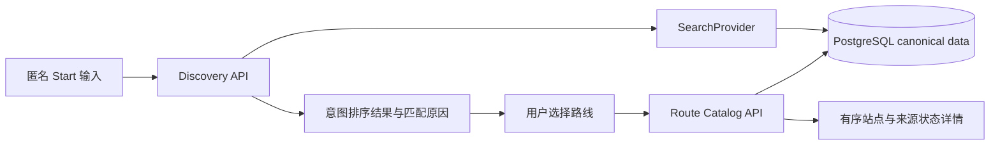

# START 当前状态报告

审查日期：2026-10-01（Asia/Shanghai）。状态：接管审查完成，第一开发切片为建议，等待产品负责人确认。本轮没有修改功能代码、依赖、数据库、旧计划或角色素材，没有提交、合并、部署，也没有创建 Figma/Canva 页面。

## 1. 交接包与裁决依据

已读取 `D:/START_CODEX_MASTER_HANDOFF_v1.zip`，SHA-256 为 `03619C3D264FAC3EFD96A56FB051B840C7A13A642AC4266359B5E75C26649813`。解压审查副本位于 `D:/Downloads/fan-route-codex-handoff/handoff-review-2026-10-01/START_CODEX_MASTER_HANDOFF_v1/`；56 个文件与 ZIP 逐文件哈希核对，差异为 0。包含 24 个 Markdown、2 个 TXT、1 个 CSV、1 个 JSON、26 张参考 PNG、1 张用户评论 PNG、1 张总览 JPG。

先读根目录 `00_README_FIRST.md`，随后严格按其 13 步顺序读取：Master Context → PRD → Product Design Spec → IA → Decision Log → Data Model → Technical Architecture → Engineering Reference Map → Mature Project Learning Pack → Development Workflow → Repository Structure Proposal → MVP Acceptance → Visual Pack。视觉包按其 README 阅读 Library、Rules、Manifest、Checklist，再查看 Contact Sheet；已查看所有 26 张参考图总览，另打开 REF_02、07、14、24、25、26 原图和用户字体/配色评论截图。按视觉包要求，其余原图仅在需要细部判断时再打开，原文件均未修改。随后补读根目录启动文本、用户下一步、研究来源 JSON、包清单，以及 Architecture Diagram、License Notes、ADR Template、Open Decisions、P1/P2 Backlog 和视觉启动文本。

当前用户要求及本轮补充的工具规则优先；包内 Decision Log → PRD → Product Design Spec → Architecture → Visual → 历史资料用于文档冲突裁决。包内要求额外输出视觉理解、以后实施或运行 vendor spike 的文本作为交接资料处理，不作为本轮新增任务。旧 AGENTS、旧启动提示词与旧计划不能重新授权本轮编码。

锁定边界：中国大陆首发；Mobile Web → 微信小程序 → 后续 App，共享后端与数据；主导航仅 Start / Community / Me，Journey 属于 Start；首页核心为 `Start with [ ... ] ?`；用户路线投稿、审核与完成纪念海报均为 P0。Community P0 限 For You / 我的社群 / Event Hub / 现场物料交换；完整 IM、拼房、复杂 Together、支付和宠物养成不进入 P0。Modular Monolith、PostgreSQL-first、Provider Adapter 是目标架构，地图与导航使用成熟服务。

## 2. 仓库、Git 与已有工作

外层 `D:/Downloads/fan-route-codex-handoff/` 是交接工作目录，不是 Git 仓库。真实仓库与 Git worktree 如下，不能将任一分支成果当成已经集成到主分支。

| 工作区 | 分支 / HEAD | 已完成内容 | 当前局限 |
| --- | --- | --- | --- |
| `fan-route-codex-handoff/` | `master` / `1def607` | React 19、TypeScript、Vite、Router；首页、单路线详情、进行中、导航模拟、到达推进、完成反馈；localStorage、收藏、分享链接、统一检查入口 | v0.1 演示基线，真实搜索、后端持久化、实际导航均未闭环 |
| `.worktrees/fan-route-v0.2/` | `feat/fan-route-v0.2` / `b9a4623` | 地图领域模型、服务端高德适配、错误归一、缓存、局部重算、幂等与版本冲突、4 个地图 API、人工确认南京种子 | Task 7 未完成；页面仍大量依赖旧兼容模型；未合并 |
| `.worktrees/character-asset-baseline/` | `feature/character-asset-baseline` / `a8ece97` | R01/R02 身份母版、8 张表情、8 张动作；18 张正式透明资产；格式、锚点、覆盖率门禁 | 尚未接入前端；没有完整换装、独立配饰、侧背面、连续动画；验收相关修改未提交 |

Git 历史已核对所有本地分支：`5b69837` 建立 v0.1，`1def607` 建立统一检查；`fbf9b2c` 与后续修复建立地图模型；`d850e92`、`82aecbd`、`6ae02c6` 建立/加强高德适配；`98919df` 局部重算；`ea5f619` Worker API；`bfebba2` 真实种子；`b9a4623` Task 6 验收记录。角色分支从同一基线分出，`96346a3`、`4f7d7c7`、`65191f2`、`a8ece97` 分别对应门禁、母版、表情、动作。

三处均有既存未提交修改。主仓库有视觉参考说明与素材、角色资料及计划；v0.2 有修改后的 `src/App.test.tsx`、未跟踪的 `src/api/`、routeRepository、产品/ADR/研究/许可证/计划文档；角色分支有 README、manifest、校验器、package、测试和验收文本修改。全部保留，本轮未重置、覆盖或整理这些修改。运行检查产生的是构建产物和审查日志；检查后原有 Git 状态保持，报告作为新增文档保存。

## 3. 开发进度与旧 Task 核对

旧 v0.2 计划 Task 1–6 已有实现提交；Task 4–6 另有 `docs/qa/task-4-review.md`、`task-5-review.md`、`task-6-review.md` 的审查与修复记录。Task 1–3 未发现同形式的独立验收文件，不能补写成已证明完整复审。Task 7 已有 API client 与本地已发布路线查询及测试，但 HomePage 没有消费查询结果、仍自动打开固定路线，因此为部分完成。Task 8 详情/编辑、Task 9 真导航、Task 10 埋点与异常验收、Task 11 实机与用户验收没有形成完整交付证据。

2026-09-28 的 v0.3 产品架构、核心流程、三个 ADR 和 Planning Foundation 均为 Proposed；计划中的复选项未完成，不能把目标目录和契约当成实际代码。特别是角色母版已经存在，旧计划中再次要求先制作/批准母版不能触发重复生产，应核对已有资产门禁与实际授权。

同时检查了应用中的相关历史 Task：`汇报 Fan-route 开发进度`、`制作安溥南京路线网页原型`、`图` 的可访问近期记录，以及仓库旧交接索引、三份 2026-09-15 文档、v0.1 产品/页面/流程/验收文档、design-qa 和 `audit-2026-09-28/` 截图记录。聊天只用作定位线索，完成状态以当前文件、Git 与本次测试为准；本轮没有向旧聊天发送任务。

Task 6 的证据链是 `source → candidates → selections → confirmed seed`。已记录人工选择五组候选的第一项，正式数据含 5 个 confirmed POI、4 个服务商计算路段，合计 1496 米/1198 秒。当前种子 `computedAt` 为历史时间，`fresh` 字段不能解释为今天实时刷新。地点确认为真实 POI不等于“安溥关联事实已核验”：故事、来源证据、图片、开放时间、入口仍待补齐；停留分钟均为 0，约 20 分钟仅代表交通汇总。保留这条历史地图数据链，但不得把路线标为全部事实已审核。

## 4. 本次实际测试

环境：Node `v24.18.1`，pnpm `11.25.0`；使用已有依赖，没有安装或升级。下表均为本轮运行结果。

| 工作区 / 命令 | 结果 | 证据 |
| --- | --- | --- |
| 主仓库 `pnpm check` | 退出 0；typecheck、Vitest 21/21、build、Node 5/5 通过 | 外层 `handoff-review-2026-10-01/main-check.log` |
| v0.2 `pnpm typecheck` | 通过 | `v02-typecheck.log` |
| v0.2 `pnpm test:run` | 退出 1；47/52 通过，5 项 App 测试失败；6 个测试文件中 1 个失败 | `v02-frontend.log` |
| v0.2 `pnpm build` | 通过 | `v02-build.log` |
| v0.2 `pnpm test:worker` | 60/60 通过 | `v02-worker.log` |
| 角色分支 `pnpm check` | 退出 0；资产测试 13/13、validator valid=true/released=18/errors=0、typecheck、Vitest 21/21、build、Node 18/18 通过 | `character-check.log` |
| 三处 `git diff --check` | 通过；有 LF/CRLF 提示 | 当前 Git 检查 |

v0.2 的 5 个失败覆盖角色与输入顺序、匹配结果不自动跳转、诚实空状态、空搜索推荐、快捷条件。失败中存在测试选择器漂移：`getByLabelText("搜索已有路线")` 实际选中顶部按钮，而非输入框；测试期望的 `搜索路线` 提交按钮也尚不存在。因此“快捷条件值为空”的失败不能直接认定 `addCondition` 坏了。但源码已独立证明缺失真实结果状态，不能只改测试文案让其转绿；应按新产品契约重新核准行为断言。

主原型检查通过只证明历史原型回归通过，不等于最新 START MVP 验收通过。v0.2 已确认存在前端失败，统一 `check` 门禁不能视为全绿；本轮分项执行避免前端失败掩盖 Worker 和构建状态。没有运行真实高德调用、真实设备导航、目标用户测试或新一轮浏览器视觉验收；旧截图与旧 design-qa 仅为历史证据。也没有 PostgreSQL 实例/迁移链可供现有仓库验收。

## 5. 保留与迁移判断

| 现有资产/代码 | 判断 | 下一阶段处理原则 |
| --- | --- | --- |
| React/TypeScript/Vite、Router、现有测试与打包入口 | 保留 | 没有证据需要换框架；共享 API/领域契约，不要求三端共享 UI |
| `worker/map/amap.js`、errors、cache、`worker/route/calculate.js` 及测试 | 保留已验证逻辑 | 收进明确地图适配和路线计算边界，不自建算路；高德是现有实现，最终 vendor 仍待 ADR |
| 确认种子、候选/选择记录、nullable 路段语义 | 保留 | 迁入 canonical Place/Route/版本数据；保留来源、坐标系、时间；不重新猜 POI |
| `src/data/routeRepository.ts` 与测试 | 保留作过渡接口/用例 | 目前只有内存单路线子串匹配，未来接 SearchProvider；不当生产搜索服务 |
| routeSession reducer、非法快照恢复、防重复到达、导航返回不自动推进 | 保留规则和回归用例 | 持久化改为用户 Journey，并固定路线版本；localStorage 只作缓存/恢复辅助 |
| TopBar、弹层、操作区、Timeline | 条件复用 | 复用可访问性与操作结构，按新信息层级审查，避免旧页面决定产品架构 |
| R01/R02 和 18 张正式角色资产、manifest、校验器 | 保留 | 不重新生成脸；以后独立 DollRenderer/槽位方案与产品接线；自动门禁不代替视觉身份审核 |
| NavigationSimulationPage、定时固定跳转、四项底栏、旧星宠主视觉 | 仅保留历史演示/测试证据 | 不能进入新 MVP 的正式行为；本轮不删除 |
| v0.3 ADR 的模块化单体、版本/Journey 分离、供应商隔离思想 | 保留设计输入 | 重审其状态与最新范围，不能默认为 Accepted |

## 6. 最新 START 与现有实现差异

| 最新要求 | 当前状态/冲突 | 性质 |
| --- | --- | --- |
| Start / Community / Me；无独立 Go | AppChrome 为首页/社区/行程/我的；旧 v0.3 为首页/行程/足迹/我的且移除 Community | 明确 IA 冲突 |
| `Start with [ ... ] ?`，意图加权搜索 | 旧中文提示、整理路线语义；任何非空输入定时跳至固定路线；查询模块未接线 | 核心入口冲突与缺实现 |
| Artist/Route/Place/Event 等种子实体 | 艺人、城市是路线字符串；只有一条路线与地图 Place；未有独立 Artist/Alias/Event | 数据建模缺口 |
| PostgreSQL-first、共享后端 | 前端 JSON/localStorage；Worker 地点、版本、幂等存储默认 `Map()`；无迁移 | 持久化与跨端架构冲突 |
| Route、公共版本、Journey 独立生命周期 | `RouteStop.visitStatus` 混入公共内容；全局单路线进度；Journey 没有开始版本快照 | 领域生命周期冲突 |
| 来源、事实验证状态、投稿人、纠错 | POI confirmed 与服务商路段齐备；艺人地点关联证据和审核状态不完整；页面还笼统称 POI 待核验 | 信任语义不准确 |
| 投稿路线与审核为 P0 | 无创作、草稿、提交、审核后台；旧文档排除或后置 | 优先级冲突 |
| 完成纪念海报为 P0 | 完成页仍说“后续版本生成”；没有 PosterRenderer/MediaAsset/START Book | 优先级冲突 |
| Community 四个限定 P0 模块 | 社区按钮只有 toast；旧 v0.3 排除物料交换 | 范围冲突与缺实现 |
| 娃娃为陪伴载体、身份锁定、基本换装 | 运行时是 `StarPet` 单张星形吉祥物，正式棉花娃尚未接入；没有发现饥饿/喂养/EXP 系统 | 角色产品缺口；无需清除并不存在的养成系统 |
| Provider Adapter | 现有地图层已部分隔离，但 domain literal `provider: "amap"`；缺 Search/Auth/Storage 等边界 | 可演进基础，不能声明已经全解耦 |
| 最新视觉包为源依据 | 旧 CSS 广泛玻璃效果、紫色圆角卡、抽象城市图复用；旧粉紫奶油截图不能压过新视觉包 | 视觉权威与表达冲突 |
| 正式 UI 先 FIGMA_PLAN，确认后 Figma | 当前只有截图/代码/生成图与旧 QA；本轮未创建正式 Figma 设计 | 工作流缺口，禁止用代码反向代替设计 |

## 7. 技术债与风险

主要技术债是单路线硬编码和全局状态耦合、JS Worker 与 TS domain 双份契约、成功响应直接 `body as T` 而未做完整运行时验证、供应商身份侵入 canonical ID、内存存储无法跨实例/重启恢复，以及 public route 和 user journey 状态混合。`worker/api.js` 约 14.6 KB，集中 HTTP 校验、存储与版本保留逻辑；应在切片迁移时拆职责，不先做全仓目录重排。

发布风险包括未建立服务端账号/写权限/审核与审计体系、客户端原型收藏匿名持久化与最新登录规则不一致、未形成统一媒体注册和授权链、历史 `fresh` 时间失真、地图实体确认被误当粉丝关联证据、以及国内部署可达性/存储/CDN/微信身份/内容审核未做 vendor 评估。地图 tests 中的限流错误分类不等于部署侧已经配置频率限制；mock 的 Key/超时测试不等于当前线上 Key 和配额有效。当前未核验线上部署和密钥状态，不输出或请求秘密值。

Git 风险是成果分散于三分支和大量未跟踪文件，尤其角色验收修改与 Task 7 测试不能丢失。开始下阶段前需确定承接 worktree、逐项审查需迁入的改动并形成可回退基线。自动测试覆盖的是旧范围，缺最新端到端、审核发布过滤、数据库约束、版本快照、海报与投稿验收；不能用通过的 21 项原型测试证明 P0 完成。

## 8. 推荐第一纵向切片

推荐 **匿名 Start 输入 → 有依据的搜索结果 → 已发布路线详情（只读）**。这是主交接 Workflow Slice 1，也是现有 Task 7 与只读详情迁移能汇合的最小可验证用户结果。它不是重做 Task 1–6，不包含路线调整、实机导航、海报或完整投稿开发；海报与投稿仍在本版 P0 后续切片，不能被后移至 P1。

小架构方案：保留 React/Web 与已经测试的地图逻辑；一个后端部署单元内先形成 discovery、catalog 的服务边界。PostgreSQL 保存最小 Artist/Alias、City、Place、Route、RouteStop、RouteRevision/证据引用，以版本与发布状态区分公开内容；SearchProvider 首个实现读取 PostgreSQL，返回公开 DTO。界面只消费 API，不直接读 DB 或供应商原始响应。不为未来模块建空服务，也不引入消息总线、搜索集群或微服务。

首切片可复用已确认南京 Place/路段快照，但路线艺人关联未核验应显式展示。正常 published 内容应满足来源与审核要求；该历史路线若未达到发布门槛，就保留为标明状态的受控审查数据，不能因第一切片需要内容而自动批准。首批艺人/城市/路线选择仍是 Open Decision，本报告不新增虚构种子。

验收包括：匿名可浏览；首页核心入口与三个导航边界正确；按艺人/城市/地点/事件及简单自然语言意图匹配已有数据，不声称生成路线；无结果不固定跳转；已发布内容才能公开，详情可追溯版本、ordered stops、来源与独立验证状态；距离/时长不可用为 null/明确文案；返回保留查询；错误可重试；两次乱序搜索不覆盖较新结果；从干净 PostgreSQL 迁移并导入合法种子；前端、领域、API/DB 集成与浏览器主流程验证通过，并独立审查闭环。更细验收见 `REFERENCE_NOTE_001.md`。

从这里开始的原因：直接关闭已知搜索假行为与 5 项回归缺口；复用已投入的地图数据和合同；用只读数据验证 canonical schema、证据、发布过滤、Provider 与共享 API，为后续投稿和 Journey 建基础；不提前承担地图导航和媒体写入的不确定性。只做字符串搜索补丁仍达不到 START 架构，因此 PostgreSQL/共享 API 的最小基础应包含在该切片计划中。

## 9. 视觉、工具与后续门禁

新视觉结论是 REF_26 的克制档案骨架加摄影/局部鲜活手写表达；不是全局粉紫玻璃，也不是全屏拼贴。关键参考：REF_26 结构与档案、REF_02 摄影/标题、REF_07 路线 Hero、REF_06 人物局部拼贴、REF_14 记忆注释、REF_25 身份卡与手账、REF_24 活动物料、REF_16 纪念路径。普通功能正文、地图、表单和审核保持清晰；REF_12/17/19/20/21/22 的 POSTER_ONLY 不扩散到常规 UI。三个重点避免项是重复圆角卡堆叠、装饰覆盖真实地图/事实、把角色或彩色字做成儿童宠物界面。

Start 首页使用 REF_26 + REF_02 的单一表达，Route Detail 用摄影 Hero 和一处 REF_07 标题，Journey 以地图与下一动作优先；Community 用克制策展模块和少量 REF_06/25 人物表达；START Book 用 REF_14/25/26，完成海报才允许更丰富的超现实与拼贴。此处仅为参考解释，不是 UI 设计定稿。

工具规则已纳入：逻辑/IA/关系/状态/API 用仓库 Markdown 和简单 Mermaid；页面结构先低保真；Canva 只承担 Moodboard、概念、海报和拼贴；正式 UI 由 Figma 沉淀 Tokens、组件、状态、响应式、交互、原型和交接规格。正式 UI 前先输出 FIGMA_PLAN.md，经确认才建原型。正式编码前必须已有对应 PRD/交互/数据/架构/视觉/Reference Note；工程不反向替代产品设计。

本轮交付仅本报告和成熟项目学习记录。地图、国内部署、登录、存储、CMS、审核供应商均未锁定；进入下一阶段须得到产品负责人确认，不自动开始实现。
