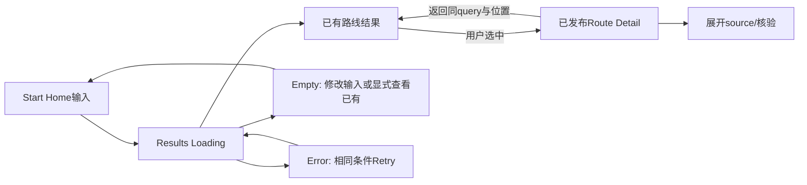

# START Slice 001 — Figma 正式 UI 实施计划

日期：2026-10-01。状态：计划待确认，未创建 Figma/Canva 文件、低保真图或高保真页面。只覆盖 Slice 1B：Start Home → Search Results → 已发布 Route Detail。正式产品 UI 的 source of truth 为 Figma，工程依据批准的文件/node版本实现；本文件不是 UI 定稿。

依据：已批准 CURRENT_STATE_REPORT、REFERENCE_NOTE_001、本轮 1A/1B 范围与交接包 Product Design Spec/IA/视觉包 v2。逻辑与状态以 SLICE_001_IMPLEMENTATION_PLAN 为准，Git 保护以 INTEGRATION_BASELINE_PLAN 为准；三者冲突时先修正文档，不让代码或生成图决定产品结构。1A可先实施数据/API，不因本计划存在就开始1B页面编码。

## 1. 设计顺序、文件组织与确认点

先用仓库 Markdown/Mermaid 明确任务、信息层级、状态与API字段，再做低保真结构；结构确认后制作正式Figma页面/组件/Prototype。Canva仅在必要时做摄影/标题关系的概念草图、Moodboard或海报实验，不创建整套正式UI、不作为组件/交接源。当前无需Canva，不为了工具可用而使用。

批准计划后，建议创建一个 Figma Design 文件 `START / Mobile Web / Slice 001`，以下是拟建 pages 而非当前已存在文件。用本文件名履行正式UI前先计划的门禁，不另生成泛化 FIGMA_PLAN.md。

| Figma Page | 内容 | 顺序与交付 |
| --- | --- | --- |
| 00 — Brief & Reference | 范围、三导航、只读动作、视觉参考链接、使用/不使用理由与授权备注 | 第一步。明确未实现Community/Me/下一切片，不画完整社交/档案模块 |
| 01 — Flows & Wireframes | 三页低保真、loading/empty/error/404、返回流程、API字段与主次任务 | 先做，结构批准后才进正式视觉；逻辑源仍在仓库文档 |
| 02 — Foundations | Color、Typography、Spacing、Layout、Radius、Border、Motion、Icon与Media规则 | 与关键页共同验证，避免先造庞大设计系统 |
| 03 — Components | 当前切片真实需要的组件、Variants、States、Auto Layout | 跟随页面沉淀，未用组件不预建 |
| 04 — Mobile Web Screens | 390×844三页主状态及完整异常/内容边界 | 正式页面source，全部真实文本或明确测试占位 |
| 05 — Responsive | 320、768、1280的代表页、宽度/列数/文字图片规则 | 不为未来App/小程序画一套全新UI |
| 06 — Prototype | Happy path、empty/error/retry、返回上下文、直接链接、撤回 | 连接 approved variants，区分模拟数据与真实API状态 |
| 07 — Handoff & Review | node索引、设计版本、字段映射、tokens、组件行为、媒体来源、验收记录 | 页面编码前批准；工程截图记录实现，不覆盖Figma规范 |

确认点：本计划确认 → 低保真任务/结构确认 → 正式页面与Tokens/状态/响应式确认 → Prototype与交接确认 → 才开始1B工程。本轮只到计划交付，不跳过中间确认点。正式设计前应打开 REF_02/07/26 原图与 Library/Rules/Manifest/Checklist，对照完整Contact Sheet；上一阶段阅读记录可复用，不把旧粉紫截图作为默认方向。

## 2. 页面任务与信息顺序

| 页面 | 核心用户任务 | 首屏/主体的信息顺序 | 当前主动作 |
| --- | --- | --- | --- |
| Start Home | 用艺人、城市、地点或一句简单意图查已有内容 | START身份与一处摄影表达 → `Start with [ ... ] ?`输入 → 明确“搜索已有内容”语义 → 可选少量已有艺人/城市词项 → 三项主导航 | 搜索，Enter等同提交。空输入查看已收录路线，不声称AI生成或猜你喜欢 |
| Search Results | 判断哪些路线匹配、手动选择一条 | 返回/可编辑query → 结果数量与匹配条件 → 结果行：路线名、艺人/城市、站数与交通指标、匹配理由、核验摘要 → 后续结果入口 | 打开选中的路线，结果完成不自动跳转 |
| Route Detail | 理解路线内容、站序、艺人关联与可信程度 | 返回 → 摄影Hero与路线身份 → 当前公开revision/日期及指标 → 核验摘要 → ordered stops与各自来源/说明 → 公开来源区 | 查看路线站点（页内定位）；不提前实现开始Journey/收藏/投稿 |

顶部摄影与标题是阅读入口，不能把搜索推到首屏以下。首页第一viewport必须能理解主要任务并找到输入/提交；键盘打开时仍可操作，不强求底栏始终可见。详情不将0停留的历史交通时长标成总游玩时间；来源/核验必须可发现，不能只藏在页尾免责声明中。

三主导航只有 Start / Community / Me，Search/Detail属于Start。Community/Me仅设计当前未开放的诚实边界反馈，不能暗示已能使用完整模块；不新增独立Go/行程Tab、不以额外菜单提前放收藏、Journey、投稿。路线投稿与海报仍是后续P0，但本切片没有无行为的“立即投稿/开始复刻/生成海报”假按钮。

## 3. 视觉参考映射与设计意图

视觉包路径：`D:/Downloads/fan-route-codex-handoff/handoff-review-2026-10-01/START_CODEX_MASTER_HANDOFF_v1/05_VISUAL/START_CODEX_VISUAL_REFERENCE_PACK_v2/`。引用包中原图，不将参考里的摄影、品牌字形或人物直接剪出当产品资产。

| 页面/表面 | Functional priority | Structural reference | Expressive reference与选择技巧 | 不复制的内容 |
| --- | --- | --- | --- | --- |
| Start Home | 三秒内理解并提交搜索 | REF_26：中性色、留白、编辑式层级 | REF_02：一张有城市/追星语境的主摄影与标题关系；只允许一处有生命力的字形/批注，输入和按钮保持功能字体 | 原版logo、照片、布局坐标；不把所有文字做手写、不增加满屏贴纸 |
| Search Results | 扫读相关性/核验并选路 | REF_26：档案条目节奏、信息对齐与轻分隔 | 延续首页摄影色彩，缩小媒体表达；结果以行/分区列表呈现，一处匹配文字强调即可 | 不把REF_02大标题重复到每结果，不重复圆角封面卡，不做瀑布流 |
| Route Detail | 识别路线与读取有序站点/来源 | REF_26：清晰正文与档案组织 | REF_07：摄影Hero/景观与路线标题关系；一处手写标题或注释，站点和指标保持清楚 | 不做旅游地图dashboard，不用装饰轨迹代替真实路线，不每站涂鸦 |
| Loading/Empty/Error/Source展开 | 理解当前状态并继续操作 | REF_26：安静结构与可读层级 | 原页面媒体比例保留、少量状态色；无需新增表达参考 | 不用娃娃大动画遮住错误，不做虚假路线骨架内容或AI思考演出 |

普通页只用白/偏白/克制中性基底，加来自摄影或一处表达的局部鲜明色；具体色值在Figma确认，不自行锁定一套新品牌色。REF_26的留白需适配手机任务密度，不能机械扩大空白。REF_02/07是摄影/标题关系参考，不是照抄屏幕。REF_12/17/19/20/21/22等 POSTER_ONLY 不能扩散进本切片功能页。

已验收R01/R02与18张角色资产保持身份权威；本切片不为展示资产而强行加娃娃。若低保真/正式设计确认需要一处陪伴表达，只使用现有released资产、标记asset ID，不生新脸/动画/养成系统。缺少可公开照片时用明确中性缺图版式，不用生成“艺人到访照”冒充证据。

## 4. Design System 的最小范围

| 类别 | 需要沉淀的Token/组件 | 必须设计的状态/规则 |
| --- | --- | --- |
| Typography | display、page-title、section-title、body、caption、metadata、input/button | 功能中文默认16px阅读级别，caption建议≥12px；展示字体只局部使用。字体fallback/中文覆盖/许可证；长标题换行，不做全文手写 |
| Color | surface/base、text/primary/secondary、border、action、focus、status/verified/pending/disputed/error、局部accent | 状态文字/图标共同表达，不只靠颜色；正文对比≥4.5:1、控件/大字按对应标准验收；色值待设计确认 |
| Layout | spacing候选4/8/12/16/24/32/48、content-width、gutter、safe-area、header/nav-height、photo-ratio | 这些是候选不是批准Token；Auto Layout、hug/fill、长内容扩展、sticky/scroll边界写清 |
| Surface/Motion | radius只用于必要控件、border、minimal shadow、focus ring、短transition/reduced-motion | 不默认玻璃/模糊，不将一切包在同样圆角卡中；无大型loading演出 |
| Navigation | AppNavigation（3项）、BackLink、PageHeader | active/focus/pressed、未开放反馈、Search/Detail归Start；直接链接返回默认Start |
| Search | StartPrompt、SearchField、SubmitButton、QueryContext、MatchReason、ResultsCount | idle/focus/composing/loading/error；label独立于placeholder，输入可清除，Enter/按钮一致，IME不误提交 |
| Content | RouteResultRow、RouteHero、RouteMetadata、MetricValue、RouteStopRow、SourceRow、SourceDisclosure | 可变标题/照片比例/缺图、null指标、长地址、不同source数量；不预建全CMS卡片库 |
| Trust | VerificationSummary、VerificationLabel、SourceAvailability、RevisionMetadata | 地点确认/艺人关联/事实核验分开，partial不等于verified，历史时间明确；状态有简短解释 |
| Feedback | InlineLoading、Skeleton、EmptyState、ErrorState、RetryButton、RouteUnavailable | first-load与re-query区别；skeleton不闪烁，aria-live/focus/屏幕阅读行为纳入handoff |

组件使用语义命名与Variants，不按“紫色卡片1”命名。API字段对照组件属性；Design Tokens导出格式在Figma交接时与CSS变量映射，不让CSS已有值反向定义设计。先做页面中真正使用的组件，不预建登录、投稿、Journey、Event、交易、海报或换装系统。

## 5. 必要页面状态与内容边界

| 页面 | 必须出现的frame/variant | 信息与动作 |
| --- | --- | --- |
| Home | idle、输入focus/中文键盘、长query、参数错误 | 英文核心句与中文功能label同时可理解；超长query给明确反馈，不截断后偷偷换词搜索 |
| Results | initial loading、re-query loading、results、empty、error/retry、空query default、更多结果loading/error | 保留当前query；新的query不把旧结果伪装为新结果，初次失败无“0条”误导；重试同条件；empty只调整搜索或显式查看已收录路线 |
| Detail | loading、正常、缺图、指标null、partial核验/来源暂不可访问、来源展开、error/retry、404/withdrawn | 404说明当前不可查看，不泄露草稿；合法公开来源保持可读；retry与返回为明确路径 |
| 全局 | API异常、按钮focus、长标题/地址、无授权媒体、底部safe-area、浏览器后退 | 错误不自动跳首页；一屏一个主动作，恢复焦点与滚动规则明确 |

数据frame标明来源：正式经审查内容、历史待核验素材、synthetic测试数据。南京历史seed可用于内部信息密度评估，必须标明未发布，不能画成“全事实已核验”的上线稿。正式视觉验收需要真实授权Hero素材；缺素材不影响状态设计，但真实内容就绪门禁保留。

## 6. Prototype 必须证明的交互

原型场景：①艺人+城市输入、按Enter/按钮、加载、手动选路、查看站点/来源、回到同query与选中结果；②未知组合empty→修改query，或显式查看默认已有内容；③搜索失败→retry，详情失败→retry/返回；④搜索A未完成时提交B，最终只显示B（Figma演示规则，工程另有乱序测试）；⑤深链接详情→无搜索context时返回Start；⑥结果已撤回→不可查看状态→返回并重查；⑦来源折叠/展开与外链、缺图/null指标；⑧软键盘、导航安全区域、长页面滚动。

Figma模拟结果不证明真实搜索/网络/后退恢复已实现；prototype旁记录对应API和工程测试。空query进入default模式，未知query是empty，不能画成两者都会打开南京。来源外链用浏览器打开，返回不丢query，不设计未实现的编辑/纠错提交表单。指针/键盘焦点和aria-live文案作为handoff注释，不能靠视觉动效推断。

## 7. 390×844 与响应式规则

第一主要viewport为390×844 CSS px，frame不假设真实手机可用高度永远844；浏览器工具栏/软键盘会改变高度。用动态viewport和safe-area规则，固定底栏不得遮挡输入、结果或source。最低320宽测试中文长标题、地址、按钮和站点正文；图片按用途裁切、保留焦点，缺图不让布局塌陷。

390主方案为单列，结果用可扫读条目、详情纵向站序；768可增加gutter/内容宽度，1280采用受限内容列、Hero与元信息可分栏，站序阅读仍明确。响应式不把内容硬拉满屏、不自动改成小红书双列信息流；不做地图全屏底图。Figma明确各breakpoint的max-width、gap、字号、顺序与裁切；tokens确认后由工程实现，不只给三张截图。

关键交互目标建议≥44×44 CSS px，支持键盘/可见focus、状态文字、长内容与字体缩放；是否满足浏览器可访问性必须实机检查。功能正文使用清晰字形，局部标题不能盖住来源或点击区域。不同屏幕仍是一套后台数据/合同；未来小程序UI单独适配，不声称可以复制React界面。

## 8. 交接与验收

正式交接须记录Figma file URL、page/node ID、版本/确认日期，三页及状态矩阵、组件Variants、Token命名/值、响应式、Prototype链接与行为、媒体asset ID/来源/权利状态、API字段/null/verification映射、文案与可访问性注释。工程按已确认版本实现；变更先更新Figma/规格并记录，不只改代码截图。

评审拒绝项：粉紫玻璃旧视觉、重复圆角卡堆叠、高德/百度式地图dashboard、小红书/微博信息流、满屏拼贴、闲鱼市场、儿童宠物风、未实现功能的假按钮、照片被当事实证据、来源状态读不懂、装饰令搜索首屏不可见。通过标准：三秒辨认主要任务、一屏一主动作、REF_26结构与适量页面特有表达、清晰站序/事实来源、全部状态有下一步、390与窄/宽屏可读、Prototype按真实数据/API语义运行。

本轮交付仅本计划。Figma正式UI尚未创建、页面编码尚未开始，下一执行阶段仍是先经确认的Slice 1A。
