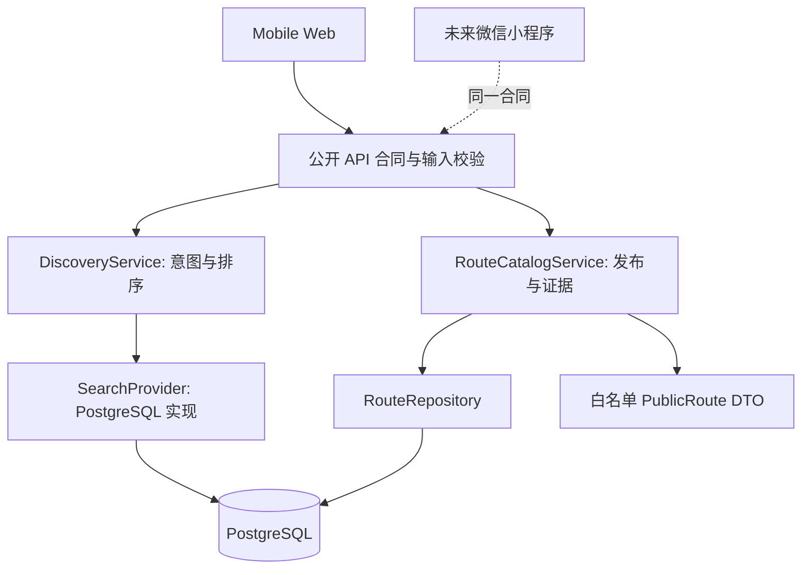

# REFERENCE_NOTE_001 — Discovery 与只读 Route Catalog

日期：2026-10-01。状态：研究记录与 START 方案建议，未引入第三方代码或依赖，未实施。对应首切片：匿名 `Start with [ ... ] ?` → 意图排序的已有内容结果 → 可信路线详情。产品依据为主交接 PRD、Design Spec、Data Model、Technical Architecture、D003/D004/D007/D008/D020–D023 与最新视觉包。

## 1. 要解决的问题

用户输入艺人、城市、地点、活动或一句出行意图，应得到真实已有内容和匹配依据，自己决定打开哪条路线。当前首页任何非空输入都定时跳入南京固定路线，本地查询只有一个 RouteBundle，公开发布、证据和独立实体不足。第一切片需要打通 Web → 共享 API → PostgreSQL → 搜索/详情的只读闭环，并为用户投稿后的审核发布与 Journey 版本快照保留正确边界。

这不是路线生成器、LLM 对话、地图引擎或全功能 CMS 项目。路线投稿和海报仍为 P0；本记录只研究先行的读链路，避免同时展开写链路。中国大陆可达性和 Web/微信小程序共享契约是设计约束，参考项目的默认云服务不自动成为 START vendor。

## 2. 搜索范围、读取方式与证据质量

先按 agent-reach 的 GitHub 路由检查 `gh auth status` 并尝试 repo search；CLI 未登录，未修改认证。公开 GitHub API 的本机 TLS 请求也失败，故使用公开网页检索与 GitHub/raw 内容阅读作为降级。搜索覆盖搜索引擎接口、Postgres 数据/迁移平台、CMS 文档发布服务，查询包括 `site:github.com meilisearch meilisearch search engine`、`site:github.com strapi strapi content manager document service`、`site:github.com supabase supabase postgres migrations`，并核对主交接参考图谱。

选取以下三个成熟项目研究职责边界，未选择追星 App 整体 fork。既有 v0.3 参考矩阵（TREK、AdventureLog、Cairn 等）作为历史研究输入保存，但本记录没有假称本轮逐仓重新审阅它们。GitHub 页面存在抓取缓存和目录加载错误：下面星标和日期是本轮可见页面快照，不保证 2026-10-01 当日精确 HEAD。没有执行参考项目测试或部署，其测试成熟度只来自文档、目录和代码中的可见机制。多个测试源文件/用户管理示例因 cache miss 未读到，明确不计为已读。

| 项目 | 可见成熟度与维护信号 | 可复用优势 | 对 START 的明确局限 |
| --- | --- | --- | --- |
| [meilisearch/meilisearch](https://github.com/meilisearch/meilisearch) | 页面约 59.4k stars；Meili 维护；提交页可见 2026-08-11 `594f0e5`、2026-08-10 `979167f`；有测试目录、TESTING 与可运行 API 示例 | 明确查询/结果、过滤/展示字段和错误契约；搜索不承担 canonical 数据写入 | Rust 引擎、搜索队列、向量/分片超出当前规模；不会替 START 处理发布审核和路线事实 |
| [supabase/supabase](https://github.com/supabase/supabase) | Supabase 维护；星标栏读取未返回完整数值，不编造；提交页可见 2026-09-11 `66e6cd1`；官方迁移/seed/reset 工作流及 Compose healthcheck | 围绕 Postgres 分离 API、身份、存储与运维；版本化迁移可复现数据基础 | 完整多服务平台远大于 START 单体；默认托管的大陆可达性和微信登录不能从 README 推定 |
| [strapi/strapi](https://github.com/strapi/strapi) | 页面约 73.3k stars、37,962 commits；Strapi Solutions 维护；提交页可见 2026-09-08 `34cdf83`；tests 目录与 Jest API 配置 | 文档身份/发布状态、查询转换与事务封装分离，适合审查 public read 边界 | 通用 CMS/i18n/plugin/enterprise 工作流复杂；draft/published 不等于 START 全部审核状态 |

星标仅用作生态规模信号，取舍依据是实际读取的边界、测试方式和产品适配。提交日期来自各仓库[Meilisearch](https://github.com/meilisearch/meilisearch/commits/main/)、[Supabase](https://github.com/supabase/supabase/commits/master/)、[Strapi](https://github.com/strapi/strapi/commits/develop/) 页面；本轮不把页面中最近可见提交称为最新 HEAD。

## 3. 关键目录、文件与所得 Pattern

### Meilisearch：搜索合同与内容存储分离

已读 `crates/meilisearch/src/routes/` 和 `crates/meilisearch/tests/` 目录；重点阅读 [indexes/search.rs](https://github.com/meilisearch/meilisearch/blob/main/crates/meilisearch/src/routes/indexes/search.rs) 的 SearchQueryGet、字段/过滤/分页参数以及 GET handler 的输入转换、授权过滤和结果输出段。另读 [TESTING.md](https://github.com/meilisearch/meilisearch/blob/main/TESTING.md)、README、LICENSE 与 LICENSE-MIT。旧猜测路径 `routes/search.rs` 不存在于可见目录，实际代码在 `routes/indexes/search.rs`，本记录使用正确路径。

Pattern：入口先校验请求，内部执行返回明确结果；空查询可以有独立默认语义，过滤和显示字段是契约；查询结果不是内容真源。测试文档关注 API 与数据库跨版本生命周期，而不只测临时空库。START 借鉴查询 DTO、发布过滤、稳定排序和重建读模型；不复制队列、Rust 引擎、向量、分片或原始 handler。该结论是对源码的架构推导，不代表 START 要运行 Meilisearch。

### Supabase：Postgres 真源与能力边界

已读 [docker/docker-compose.yml](https://github.com/supabase/supabase/blob/master/docker/docker-compose.yml) 的 db/rest/auth 配置、环境参数和 healthcheck，`docker/volumes/db/roles.sql`、`_supabase.sql`，以及 [docker/README.md](https://github.com/supabase/supabase/blob/master/docker/README.md)、根 LICENSE、[database-migrations.mdx](https://github.com/supabase/supabase/blob/master/apps/docs/content/guides/deployment/database-migrations.mdx) 的迁移、seed 和 reset 示例。Compose 是可执行部署配置，不是业务层实现；本轮没有读到请求失败的 React user-management 示例，不能用它证明账号领域设计。

Pattern：数据库是共享真源，身份、API、媒体能力各有边界；schema 演进和种子导入可复现。START 保留这一责任划分，用版本化迁移和自己的 API 契约支持多端。局限是完整 Compose 将能力分成多个服务，不能直接等同于 START modular monolith；不复制其整套服务、默认凭据、reset 命令或把 hosted Supabase 作为已选方案。

### Strapi：稳定内容身份、公开查询与发布生命周期

重点阅读 [document-service/repository.ts](https://github.com/strapi/strapi/blob/develop/packages/core/core/src/services/document-service/repository.ts) 的 findMany/findOne、validateParams、documentId 查询转换、create/publish 和 wrapInTransaction 返回段，以及 [draft-and-publish.ts](https://github.com/strapi/strapi/blob/develop/packages/core/core/src/services/document-service/draft-and-publish.ts) 全部 113 行；另读根目录 README、LICENSE、tests 目录清单、官方 [Document Service 文档](https://github.com/strapi/documentation/blob/main/docusaurus/docs/cms/api/document-service.md)。

Pattern：稳定文档身份与数据行分离，发布条件作为服务查询的一部分，写操作按事务边界封装。官方文档说明 Document Service 自身不负责输出权限清洗；START public API 因此必须单独白名单映射，不能裸返 repository 数据。START 不直接复制其发布布尔/时间戳语义为审核模型，不采用全套 CMS plugin/i18n，也不把企业审核功能当作免费可用。

## 4. 不复制与许可证边界

Meilisearch 根 [LICENSE](https://github.com/meilisearch/meilisearch/blob/main/LICENSE) 明确区分 MIT 与 BUSL-1.1 部分，社区代码按 [LICENSE-MIT](https://github.com/meilisearch/meilisearch/blob/main/LICENSE-MIT)，企业部分不能因根仓公开就视为自由生产使用。Supabase 根 [LICENSE](https://github.com/supabase/supabase/blob/master/LICENSE) 为 Apache-2.0，独立组件需另核许可证与 NOTICE。Strapi 根 [LICENSE](https://github.com/strapi/strapi/blob/develop/LICENSE) 区分 Community MIT Expat、`ee/` 与 Cloud 条款，不能把整个仓库写为 MIT。

本次只学习 pattern/interface，没有复制源码，因此没有新增依赖许可义务。今后如引入包或移植代码，应记录精确版本/commit、文件级许可证、版权/NOTICE、企业目录及服务条款后再审查。项目代码许可不自动涵盖摄影、字体、人物素材、地图数据或用户上传来源。包内历史许可证描述是研究线索，不能替代实际拟用版本的核验；Directus/Typesense 本轮未深读，不作为已批准依赖。

明确不采用：整 App 改皮、多个仓库代码拼接、微服务平台、复杂 CQRS/事件总线、LLM/向量搜索集群、未经核验的示例路线、完整 CMS 后台、聊天、支付或交易市场逻辑。

## 5. START 自己的最小架构方案

建议保持一个 API 部署单元，先实现 DiscoveryService 和 RouteCatalogService。客户端只消费公开 DTO；领域规则不依赖 React、Map SDK、CMS 或搜索引擎实现。SearchProvider 先使用 PostgreSQL；RouteRepository 管 canonical 读写，搜索是派生读模型，二者职责不同。地图计算/POI 保留现有 AMap 适配基础；详情读链路不依赖每次实时调用地图。

首切片最小数据关系建议为 Artist → ArtistAlias、City → Place、Route → 有序 RouteStop → Place，Route/Revision → EvidenceSource；公共详情固定返回明确版本。拟使用外键与 stop 顺序唯一约束，保证至少一个有效站点与版本完整性；`provider_place_id` 归供应商身份，不作为 START 永久公共 ID。坐标元数据、路段 provider/computedAt/dataStatus 与 null 语义保留。数据库表形状不直接成为客户端合同；迁入旧 source/seed 时按各字段可信度分别标记，不将地图确认升级为艺人事实审核通过。

搜索策略建议先做：输入规范化 → 别名/城市/实体匹配 → 简单意图规则 → 参数化数据库查询 → 发布过滤 → 可解释排序。精确艺人/城市匹配和路线主题相关度比统一类别网格优先；不匹配时保留输入、明确空结果。空输入是默认已收录内容，不声称理解用户；中文连续文本、简繁/别名和中英混合必须用真实测试用例验证，不能假设默认全文配置自动解决中文。PostgreSQL 全文/trigram 是否足够应以该评测决定，不预设扩展或搜索 vendor。

建议公开读取接口为 `GET /api/search?q=...` 与 `GET /api/routes/:routeId`（可带版本读取约定），返回 entityType/id/title、匹配原因、必要 metadata 与公开链接；详情返回 ordered stops、evidence/verification、指标来源和版本。这是待确认合同，不是现有接口；现有 `/api/places/search` 是地图候选查找，不能被误当作产品内容搜索。服务端强制过滤草稿/审核中/拒绝/归档内容；不能仅靠前端隐藏。canonical 下架后即使搜索读模型残留，也须阻止打开/输出被撤回内容。

Web 状态建议 idle / typing / suggestions / searching / results / empty / error，含默认/最近搜索与 retry；撤销旧请求或用请求标识阻止乱序响应覆盖。用户点结果才进入详情，返回保留查询。公开只读无登录；收藏、投稿、打卡等持久化动作未来由 AuthProvider 识别域 User，Web 与微信身份归同一个后端用户。本切片不偷偷加入收藏/登录开发。

对未来写链路，先保留完整 route status/revision 设计：draft → submitted → auto-check → human-review → needs-revision/published/rejected → archived；不以 `isPublished` 代替审核，不在首切片实现完整审核 UI。前端旧 RouteStop.visitStatus 需要从公共内容剥离，未来放入 JourneyStop；Journey 固定起始版本，个人调整不回写公共 Route。

正式页面结构先低保真，随后按用户规则提交 FIGMA_PLAN.md，经确认才用 Figma 沉淀 UI。视觉意图：任务是发现可信内容；骨架 REF_26；首页表达选 REF_02，详情局部 REF_07；一屏最多 1–2 个主要表达技巧，功能文案保持清晰。Canva 仅用于概念、海报和拼贴，不作正式 UI 源文件；不能以代码自动生成界面来反向确定产品设计。

## 6. 实现前验收合同

以下为未来实现需满足的验收条件，不代表本轮已经通过。

| 层面 | 可验证标准 |
| --- | --- |
| 范围/结构 | 主导航只有 Start / Community / Me；Journey 留在 Start；首页保留核心句式；只交付匿名搜索与详情，不实现全 P0 页面 |
| 搜索语义 | 安溥/南京/地点/事件及连续中文意图用例可匹配相应合法种子；艺人别名有效；结果含类型和匹配原因；不存在的需求为明确空结果，不能回落固定南京路线 |
| 默认/并发/返回 | 空查询为明确默认内容；loading、empty、network/error、retry 清晰；连续 A/B 查询即使响应倒序也显示 B；返回保留输入与结果上下文 |
| 内容权限 | 只有已批准公开内容进入搜索与详情；匿名不能查询草稿、待审核、拒绝、私有修订；撤回后读模型残留不造成公开泄漏；未知 ID 返回 JSON 404 |
| 信任信息 | 区分 POI 确认、艺人关联事实审核和路段数据状态；来源缺失明确呈现；历史 computedAt 不当今日实时；停留未知不宣传完整游玩时长 |
| 数据与迁移 | 干净测试 PostgreSQL 可跑版本化迁移/seed；外键、站序唯一和版本不变量有效；重复 seed 不生成重复数据；legacy 数据迁移有字段对照，不覆盖现有成果 |
| Adapter/API | SearchProvider 可用替身进行合同测试；public DTO 不暴露数据库行、provider raw response、秘密、审核私有字段；拒绝畸形 query/page/limit；参数化 SQL 与查询长度/频率边界明确 |
| 详情 | 展示 route/theme/artist、站点数、有序 Place、来源与版本；指标来自已有合法快照或不可用文案；没有地图权限仍可完成读链路 |
| 工程回归 | 先按批准行为修正测试选择器，保留无结果/不自动打开等用例；typecheck、前端、Worker、build 全通过；新增领域/DB集成测试覆盖真实边界，不能只测 mock 查询 |
| 设计与人工验收 | 已有经确认的结构/交互规格和必要 Figma 交接；390×844 与窄屏浏览器可读、键盘可完成搜索/开详情/返回；三秒可辨认主要动作；截图与真实操作证据分别记录 |
| 审查闭环 | 独立审查 public filtering、中文匹配、状态竞态、证据语义、迁移及范围；修复后回归，再记录文件/命令/截图/限制；通过测试不自动宣称真实用户价值验证 |

## 7. 下一阶段入口与未锁定决策

先确认本报告的切片边界和现有成果承接方式，再制定最小迁移/API/交互计划。后端框架、数据库托管、地图 vendor、Auth、Storage/CDN、CMS、审核与埋点服务均未锁定；有成本或平台限制的选择通过 spike/ADR，不能从这三个参考项目直接推定。实现前应锁定实际参考版本并复核文件许可证，当前网页缓存不足以作为精确供应链清单。

本轮已完成 Reference Study，仍停留在接管审查阶段，等待产品负责人确认。
