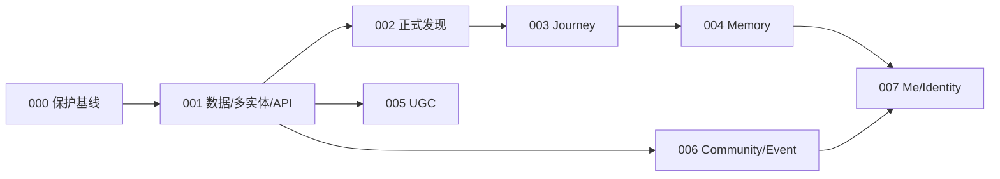

# START Slice Roadmap — V2 当前执行基线

日期：2026-10-01。状态：重新对齐的研发/验收计划，所有新START切片未开始执行。本文件采用用户明确指定的V2路线，替代旧001内1A/1B的产品切分；旧计划与旧Task记录仍是历史证据，不能继续按旧编号宣称新slice已完成。来源为V2包11/12/13与已完整读取的产品/领域/专项规格。

## 1. 切片映射与验收

| Slice | 目标与实际实施边界 | 验收证据与前置 |
| --- | --- | --- |
| 000 Git / Asset / Documentation Baseline | 延续现有三线保护：dirty备份/bundle/恢复、独立START工作区、角色/地图来源、V2文档/完整源包/hash/provenance | 三旧HEAD/status/文件不破坏，WIP/ignored审查材料可恢复，bundle验证，新工作区与文档基线存在。当前仅方案，不因哈希审查就称备份完成 |
| 001 Catalog & Discovery Foundation | Artist/Alias/City/Place/ProviderRef/ArtistPlaceRelation/Claim/Evidence/Route/Revision/Stop、Event/EventArtist最小读模型、真PG migration/seed、四entity Search/实体read API | 真PG可重建/幂等；draft/withdrawn/private不泄漏；冻结内容不漂移；允许合规approved未核验且有披露；四组查询/schema/测试；Hub读模型。消费000基线，不做正式页面 |
| 002 Start Discovery | Home含输入/推荐气泡baseline/Doll预留轻互动位置；多实体Results、Artist Hub、Route Detail、Place baseline；返回context、分享与正式开始CTA | 批准Figma五页与状态/组件/responsive/prototype；艺人用户点击入Hub、城市Artist→Route→Place→Event、无fallback、query/scroll恢复、source/trust可理解。003前开始CTA延期可见，不用查看站点替代；Doll runtime后接 |
| 003 Journey | 开始Journey、地图adapter/外部导航、进度/下一站、GPS接近提示、人确认/手动到达、Arrival故事/机位/可选照片、skip/free finish、Doll基础状态 | 固定revision快照、拒绝定位能继续、GPS不自动完成、跳站可继续/返回、3/5正常结束、进度不回写RouteStop、角色身份不漂移。消费001/002，000保护的地图与session用例按职责迁入 |
| 004 Memory | finish后自动Poster、轻量Poster editor、Memory与START Book册子表现/保存 | 结束自动触发，失败可重试不丢Journey；基于实际去过/用户照片/偶像元素，轻量编辑；Book非dashboard/数据库历史列表，Memory保存真实经历 |
| 005 UGC Route | 统一新建路线、地点/provider补齐、关联解释/证据、排序/预览/提交、自动初筛/人工审核基线、补证/拒绝/发布 | 必填相关说明/证据，初筛不判复杂事实真假，未核验标注与review日志，可新revision不改frozen；账户/写权限/上传由本切片实际需要补齐，不提前在001建空系统 |
| 006 Community & Event | section化For You/我的社群、Community baseline、Event Hub、Event-scoped Live Trade browse/publish/status | Event首屏identity/artist/time/venue/state；Trade绑定Event，粗VenueZone/识别提示、不公开精确GPS，无完整IM仍可公告与更新；非Feed/二手市场，消费001Event基础，不复建实体 |
| 007 Me & Social Identity | Me的Card/Doll/Book层级、START Card/共同点、Book integration、Doll页baseline | Card不显示match score，Me非九宫格，Book核心入口，偏好/共同点隐私、身份锁定，Doll非养成。消费004Memory与既有角色成果 |

旧1A数据/API任务由001吸收，但必须替换Route-only合同、补Event/Hub/Place和Claim状态。旧1B三页被002吸收并扩为五页，旧“查看站点”主CTA与纯搜索首页不再有效。旧v0.2 Task1–6不变成新001“已完成”，只是已有地图/确认种子/测试可用；旧角色资产完成不等于003Doll runtime完成。

## 2. 跨slice合同与依赖

编号表示当前执行顺序，图表达数据依赖，不自动授权并行开发。Route稳定ID、不可变revision、canonicalPlace、独立Artist/City/Event、显式Claim/Evidence FK贯穿后续；API/DTO多端共用，UI不假设React可复制成小程序。Artist×City在Hub内过滤，无新增City一级页；Event Hub归Community但可以从Start进入；Journey是流程不是Tab、默认不公开分享。

002气泡可先用编辑内容/简单规则，不实现关注/社群/相似兴趣完整算法；长期推荐优先级仍为关注艺人→已入社群→相似兴趣。Doll位置/轻互动设计002必须包含，基础runtime在003执行并接回首页，不因runtime后置删产品方向。sit/look/arrival等未有资产的动作在003按身份锁定处理，18张现有图不重生成。

002正式Route CTA为开始路线/分享，开始能力由003接线；阶段可deferred而非假点击成功。EventResult的target已在多实体合同，001仅read基础、006提供完整Hub；001/002验证必须标明页面未交付，不声称完整Event浏览闭环通过。

匿名可Start/Search/Artist/Route/Place/Community/Event浏览；Journey可临时体验，长期保存/Book/Card/投稿/加入社群/换物发布/收藏需要登录并returnTo。账号/provider及写授权在真正依赖它的后续节点设计/实现；登录时点细节不阻塞001。004之前必须形成可长期保存Memory的真实身份/持久化能力，不能把007身份展示页当作首次账号基础时间。

003可先验自由结束状态，004才接自动Poster/Memory；003完成不能因此说完整Journey→Book闭环完成。UGC/海报/Community/Trade/Card均仍为P0，切片后置不是降为P1。不做完整IM/拼房/复杂Together/宠物经济/重型推荐/LLM/vector/微服务/自研导航。

## 3. 通过标准与证据

每slice遵循设计/合同→行为测试→实现→独立审查→修复→回归→记录；具体执行方法后续按授权，不由此计划启动子代理。真实DB不能用mock替代，旧demo全绿不能替新START验收，Figma截图不能反向定数据模型。测试、代码、设计、正式内容、设备/大陆网络/用户验证分别记录状态和证据，未过不打accepted里程碑。

P0至少证明三条真实价值链：发现→选路线→Journey→Arrival→finish→Poster→START Book；新建路线→Evidence→审核→发布；Event→Live Trade发布/浏览/状态。001foundation、002发现或003Journey单独通过均不等于P0完成。

真内容不足时synthetic fixture只证明工程合同，不能公开假路线/假Event；媒体缺权利使用缺图，南京原seed没有自动发布权。需要内容与用户审核的案例单独确认，不重问V2已锁定的产品结构。任何merge/deploy仍需对应明确批准，不由本roadmap自动授权。

当前没有阻塞001的未定产品问题；首批内容、Event来源、vendor、匿名保存/分享细节按就绪门禁或后续slice处理。下一动作是用户确认本轮四份文档，之后先执行000，再001。本轮到计划对齐停止。
